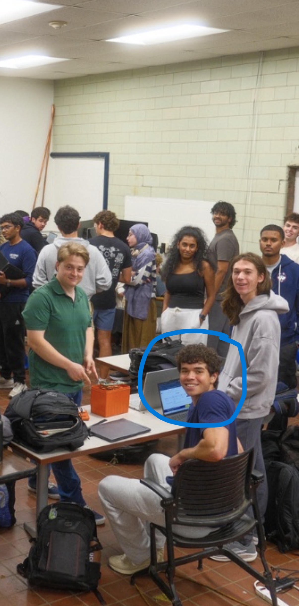

# UConn Formula SAE

An overview of my work in the EV section of UConn Formula SAE, a top-5 FSAE team.

## What I'm Working On

### Solid-State Power Distribution Module (SSPDM)

My current project on the team is helping design a Solid-State Power Distribution Module (PDM) for our EV.

Right now, the car uses traditional fuses to protect its low-voltage electronics. While these work, they have to be replaced whenever they blow, and they don't tell us much about what caused the issue. The goal of this project is to replace those fuses with electronic switches that can shut off power when something goes wrong and help us figure out what caused it.

The PDM will have six separate output channels, each designed to support loads under 4A. We're using an STM32 microcontroller to control the switches, monitor the current going through each channel, and send information about the system through CAN.

So far, we've been working on the initial schematics in Altium, including the microcontroller, power regulation, CAN communication, and PROFET switches.

There's still more work to do, including finalizing the schematics, designing the PCB, programming the microcontroller, and eventually testing everything on the car.

### PDM Project Documentation

- [MCU, CAN, and Power Regulation Schematics](Solid-State-PDM/Power%20Schematics.png)
- [PROFET Power Switching Schematics](Solid-State-PDM/PROFET.png)

---

## Previous Project

### Low-Voltage Battery Pack

My first project on the team was helping design a custom low-voltage battery pack for our EV.

The pack was planned to be around 24V and 10Ah and would power the lower-voltage electronics on the car, like the BMS, dashboard, sensors, and pumps.

I was working with two others on the design process, including figuring out how many battery cells we needed, how they should be connected, what protection the pack needed, and how we were going to monitor the individual cells.

The project also involved designing a battery pack layout in Onshape and an initial UART-to-CAN converter in Altium for communication between the BMS and other parts of the car.

Due to changes in team priorities and budget, we had to stop working on the battery pack before it was finished. I'm keeping the work here to show the progress we made before the project was discontinued.

### LV Battery Pack Project Documentation

- [LV Battery Pack CAD Design](LV-Battery-Pack/CAD.md)
- [Initial UART-to-CAN Converter Design](LV-Battery-Pack/UART_CAN.md)
