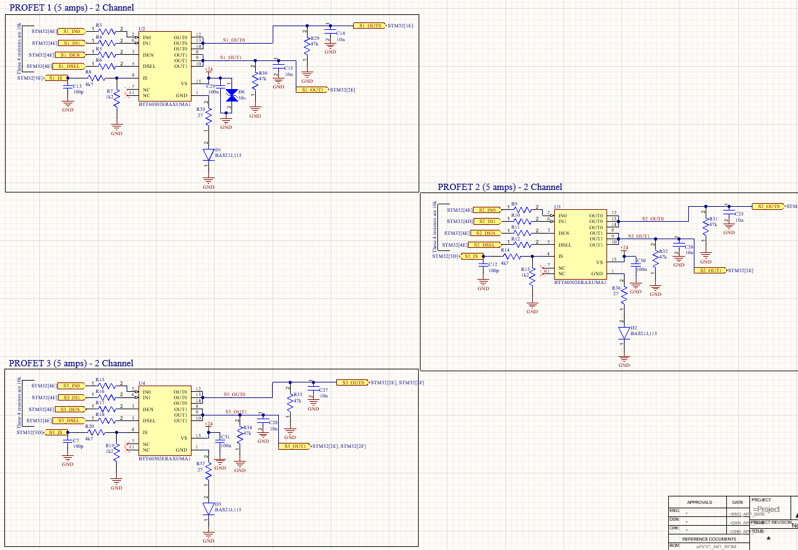

# PROFET Switching Schematics

This schematic shows the power switching section of our Solid-State PDM.

We're using three Infineon PROFET smart switches, each with two output channels, giving us six channels in total.

These switches are what allow us to replace traditional fuses. Instead of having a fuse that blows when too much current flows, the PROFETs can electronically shut off power to a circuit when a fault occurs.

Each switch is controlled by the STM32 microcontroller, which sends signals to turn the individual outputs on or off.

The PROFETs also have current-sensing and diagnostic features that we're planning to use to monitor the current going through each channel and help identify faults.

The resistors, capacitors, and diodes around the switches are used for things like filtering signals and protecting the circuitry.

Once the design is finished, the goal is to have the microcontroller monitor all six channels and report current measurements and fault information through CAN.

## Schematic

[Back to PDM Overview](README.md)
